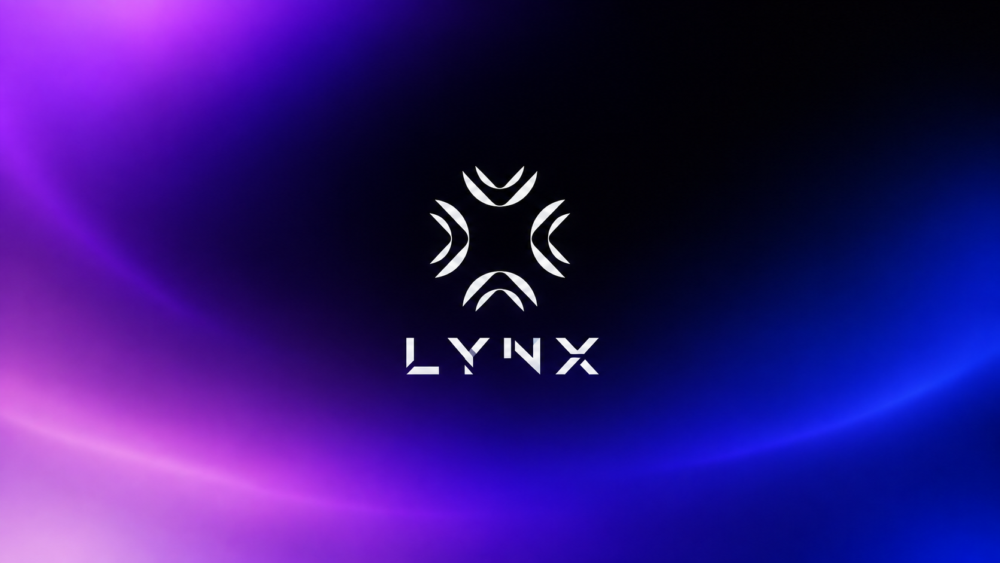

<div align="center">



**An independent, privacy-focused web search engine by [Anoneurx](https://anoneurx.com)**

`fast discovery · no tracking · open infrastructure`

[](./CHANGELOG.md)
[](./LICENSE)
[](./docs/architecture.md)

</div>

---

## What LYNX is

LYNX is a search engine built the way we would want one built: fast, inspectable, and
hostile to surveillance. It crawls the public web under `robots.txt`, indexes what it is
allowed to index, and serves results without building a profile of who asked what.

> **v0.1.0.** The §Z implementation order is complete end to end: crawler, parser,
> indexer, query processor, BM25F ranker, public API with SERP, Postgres storage,
> politeness and safety gates, observability, and the optional Astra answer layer.
> Every step is test-gated; see [CHANGELOG.md](./CHANGELOG.md). Plans beyond v0.1 —
> scale, sharding, multi-region — live in [ROADMAP.md](./ROADMAP.md) and are not
> claimed as done.

## What makes LYNX different

Three structural gaps are visible in today's landscape, and LYNX is built around
closing them rather than out-texting another SERP:

| Gap in existing engines | LYNX's answer |
| --- | --- |
| **The result list itself is rented.** Nearly every privacy-oriented or general alternative gets its organic web links from someone else's index — Bing or Google syndication (DuckDuckGo, Startpage, Ecosia, Qwant et al. are documented dependents), with Mojeek and Brave the notable independents. Your privacy can be respected upstream while the ranking you see is still produced by the company you left. | **A fully owned pipeline**: LYNX crawls under `robots.txt`, builds its own index generation, ranks with its own versioned BM25F design, and serves — no syndication contract anywhere in the loop. |
| **AI answers bloom where you can't verify them.** Independent reviews (e.g. the CJR Tow Center, 2025: all eight AI search tools tested had citation problems — for some, the majority of citations led to fabricated or broken URLs) keep finding confident answers with invented provenance, and a citation design *increases* user trust even when it is wrong. | **Fail-closed answers**: the Astra answer layer strips every sentence not carrying a verified citation, refuses rather than guesses (`killed`, `budget_exhausted`, …), and withholds below-trust pages from grounding entirely (`ai.min_source_trust`). A deployment with no answer plane renders the plain SERP — absence is honest, never invented. v0.1 verification is sentence-level and content-blind (documented in `docs/ai/astra.md`), which bounds the blast radius; it does not yet prove truth. |
| **Ranking is opaque by design.** Nobody can see, for a single request, why one page ranked above another. | **Ranking transparency is a product feature, not a press release**: `explain=true` returns the full per-result signal vector (lexical, freshness, quality, authority, context, spam, penalties) in both representations — the HTML SERP renders a per-result "Why this ranking?" disclosure with the same numbers and the ranking-config version. |

What LYNX does **not** claim: the corpus is v0.1-scale small (the crawler, not a
data centre, is the constraint), and Phase 6 scale work is future work with exit
criteria in [ROADMAP.md](./ROADMAP.md).

## Design principles

| # | Principle | Consequence in the code |
| - | --------- | ----------------------- |
| 1 | **Privacy is structural** | No query logs, no cookies, no fingerprinting, no third-party assets. See [PRIVACY.md](./PRIVACY.md). |
| 2 | **The web is untrusted input** | Every crawled byte is hostile-by-default: SSRF-safe fetch layer, no HTML execution, size/time caps. |
| 3 | **Ranking must be explainable** | Versioned, inspectable signal weights. No opaque black box. |
| 4 | **No premature distribution** | Modular monolith + worker processes. Swappable index. Scales without rewrites. |
| 5 | **Honest claims only** | Targets are labelled as targets. Limitations are documented, not hidden. |
| 6 | **Reproducible by default** | Locked toolchains, hermetic containers, pinned digests, SBOMs. |

## Repository map

```text
lynx/
├── apps/            Deployable applications: web UI, public API, admin console
├── services/        Backend workloads: crawler, frontier, parser, indexer, ranker, query, suggestions, ai
├── packages/        Shared internal libraries: models, config, logging, security primitives
├── database/        Migrations, schema notes, seed data
├── infrastructure/  Docker, Kubernetes, Terraform, monitoring definitions
├── research/        Experiments, benchmarks, datasets, papers, reports
├── config/          Layered TOML configuration (no secrets)
├── scripts/         Developer tooling
├── tests/           Cross-cutting test suites (unit, integration, e2e, security, perf)
└── docs/            All design documentation, ADRs, ERDs, diagrams
```

Every directory has a `README.md` explaining its purpose. Start with
[ARCHITECTURE.md](./docs/architecture.md) for the system view and
[docs/architecture/specification.md](./docs/architecture/specification.md) for the
complete specification.

## Documentation map

| I want to... | Read |
| ------------ | ---- |
| Understand the whole system | [ARCHITECTURE.md](./docs/architecture.md), [docs/architecture/specification.md](./docs/architecture/specification.md) |
| See the data model | [docs/database/erd.md](./docs/database/erd.md) |
| Understand crawling & SSRF defence | [docs/crawler/](./docs/crawler/README.md), [docs/security/ssrf-defense.md](./docs/security/ssrf-protection.md) |
| Understand ranking maths | [docs/ranking/](./docs/ranking/overview.md) |
| Understand the query language | [docs/search/query-language.md](./docs/search/query-parsing.md) |
| Understand the privacy model | [PRIVACY.md](./PRIVACY.md), [docs/privacy/](./docs/privacy/privacy-model.md) |
| Attack the design | [THREAT_MODEL.md](./docs/threat-model.md) |
| Ship it safely | [SECURITY.md](./SECURITY.md), [docs/security/](./docs/threat-model.md) |
| Use the API | [API.md](./API.md) |
| Run it locally | [DEVELOPMENT.md](./DEVELOPMENT.md) |
| Operate it | [DEPLOYMENT.md](./DEPLOYMENT.md), [docs/operations/](./docs/operations/observability.md) |
| Know why a decision was made | [docs/adr/](./docs/adr/README.md) |
| Know what is next | [ROADMAP.md](./ROADMAP.md) |
| See the phased timeline | [docs/timeline.md](./docs/timeline.md) |

## Honest limitations

LYNX does not claim anonymity, and it is not "zero logs". See
[docs/privacy/limitations.md](./docs/privacy/limitations.md) for the full statement:

- Operators, hosting providers, and network intermediaries can observe infrastructure-level logs.
- A query is shared with the destination site when a user clicks a result.
- HTTP-level metadata (TLS SNI, connection reuse, IP) can leak coarse timing and network info.
- The index is small compared to commercial engines for years. Coverage will be worse.

What LYNX *does* commit to: we do not build a profile of you, we do not sell or share
query data, and we document every place we store something.

## Status

| Phase | State |
| ----- | ----- |
| Phase 0 — Architecture & planning | **in progress** |
| Phase 1 — Search prototype | not started |
| Phase 2 — Crawler | not started |
| Phase 3 — Real search engine | not started |
| Phase 4 — Privacy hardening | not started |
| Phase 5 — Astra (AI answers) | not started |
| Phase 6 — Scale & distribution | not started |

## Contributing

Issues, labels, milestones, and review requirements are documented in
[CONTRIBUTING.md](./CONTRIBUTING.md). Security issues go through
[SECURITY.md](./SECURITY.md) — not through public issues.

## License

Source is AGPL-3.0-or-later so that anyone running a modified LYNX as a service must
publish their changes. Commercial licensing is available from Anoneurx.
See [LICENSE](./LICENSE) and [docs/privacy/legal.md](./docs/privacy/legal.md).