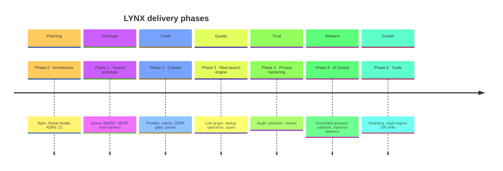
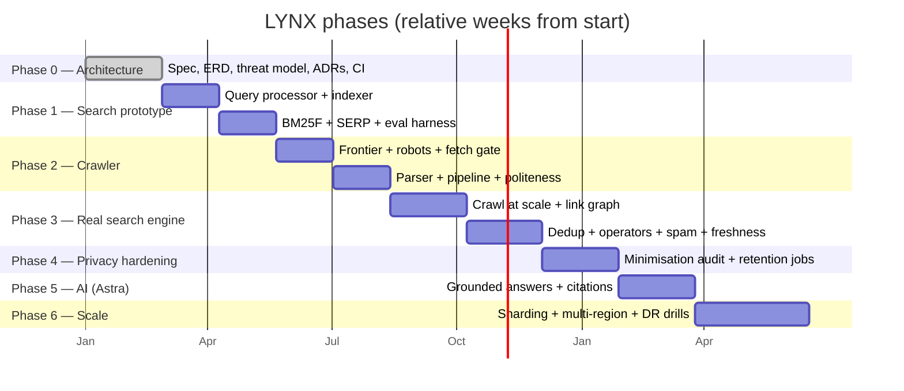

# Project Timeline

Phased delivery plan for LYNX. Timeframes are **relative** (from project start) and
**indicative** — each phase advances only when its exit criteria in
[ROADMAP.md](../ROADMAP.md) are met, not when a date arrives.

## Visual timeline

## Gantt view (relative)

## Phase summary

| Phase | Focus | Key deliverable | Gate to advance |
| ----- | ----- | --------------- | --------------- |
| **0** | Architecture | Complete design, ADRs 0001–0021, CI, repo scaffold | External reviewer can follow the design unaided |
| **1** | Search prototype | Working search over a seeded corpus | p95 < 400 ms; NDCG@10 beats baseline; privacy suite passes |
| **2** | Crawler | Responsible crawler that never touches internal infra | SSRF matrix + robots + caps pass on adversarial fixtures |
| **3** | Real search engine | Quality a user would choose twice | NDCG within reach of baseline; dup/spam/freshness targets met |
| **4** | Privacy hardening | Model survives production | Automated no-query-text audit; external review published |
| **5** | AI (Astra) | Grounded answers that don't outrun sources | Zero uncited claims; injection corpus clean; kill switch verified |
| **6** | Scale | Grow without a rewrite | p95 held at 10× corpus; region loss meets RTO in a drill |

## Milestones

| # | Milestone | Definition of done |
| - | --------- | ------------------ |
| M0 | Design frozen | ADRs accepted; open questions have owners + experiments |
| M1 | First search | Typed query in, ranked results with signal breakdown out |
| M2 | First crawl | Seed set crawled, robots-compliant, index refreshed |
| M3 | Quality baseline | Published NDCG report with methodology and limitations |
| M4 | Privacy proven | Query text absent everywhere, demonstrated by CI audit |
| M5 | Astra grounded | Answers cite sources; unsupported claims suppressed |
| M6 | Scale proven | Rehearsed multi-region failover within RTO |

## Current position

**v0.1.0 shipped (2026-10-27).** The §Z implementation order in
[docs/architecture/specification.md](./architecture/specification.md#z-recommended-v01-implementation-order)
is complete end to end — every step committed with its tests. In phase terms: Phases 0
and 2 are done; Phases 1, 3, 4, and 5 are partial, with their open exit criteria (spell
correction and the web SPA; link-graph authority and corpus coverage; external privacy
review and a production exercise; content-blind citation verification) tracked in
[ROADMAP.md](../ROADMAP.md) and summarised in the [README status table](../README.md#status).
Phase 6 has not started. See [CHANGELOG.md](../CHANGELOG.md) for the per-step record.

## Dependency notes

- **Phase 1 precedes Phase 2** so crawler work is *measured* against a known-good ranking,
  not assumed to help.
- **Phase 4 depends on Phases 1–3** — you can only audit query paths that exist.
- **Phase 5 depends on Phase 3** — grounding needs a trustworthy index to retrieve from.
- **Phase 6 is deferred** until single-node is validated; distributed infra before it is a
  documented non-goal.

## Guiding rules

1. A phase ends when its **exit criteria** are met, not when a date passes.
2. Dates in the Gantt view are illustrative sequencing, not commitments.
3. Scope changes require an ADR and a stated privacy/complexity cost.
4. "Would be nice" belongs in `research/`, not on the critical path.

See [ROADMAP.md](../ROADMAP.md) for the authoritative phase details and
[docs/architecture/specification.md](./architecture/specification.md) for the design.
